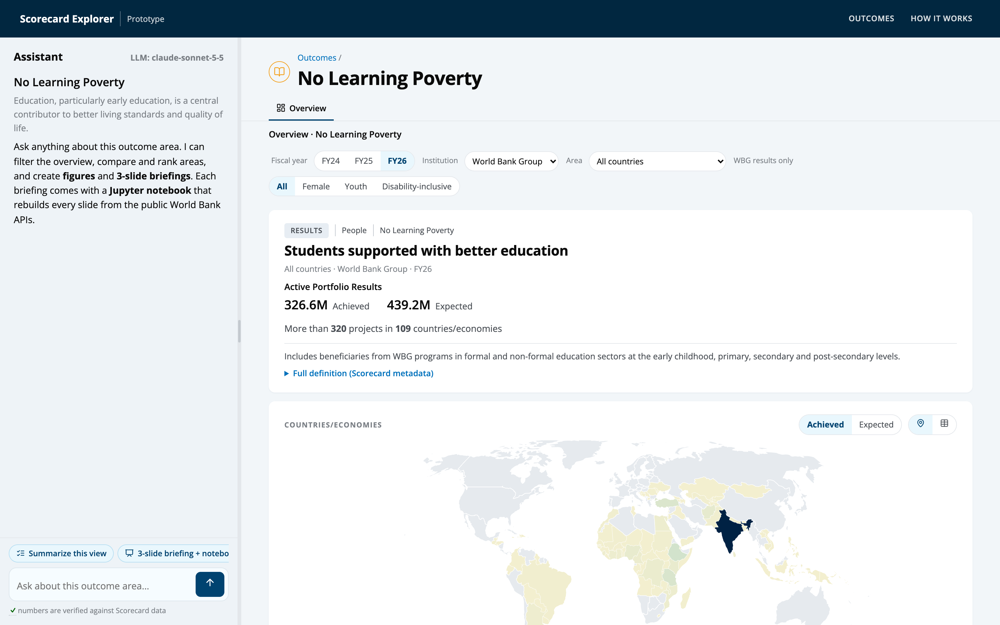
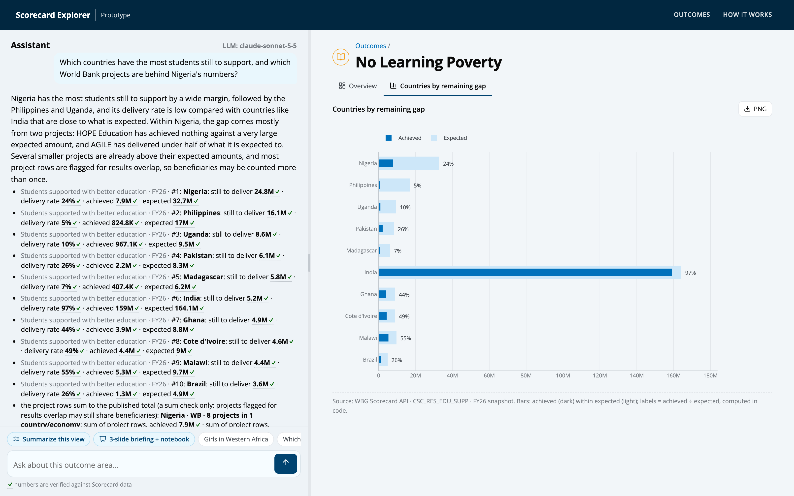
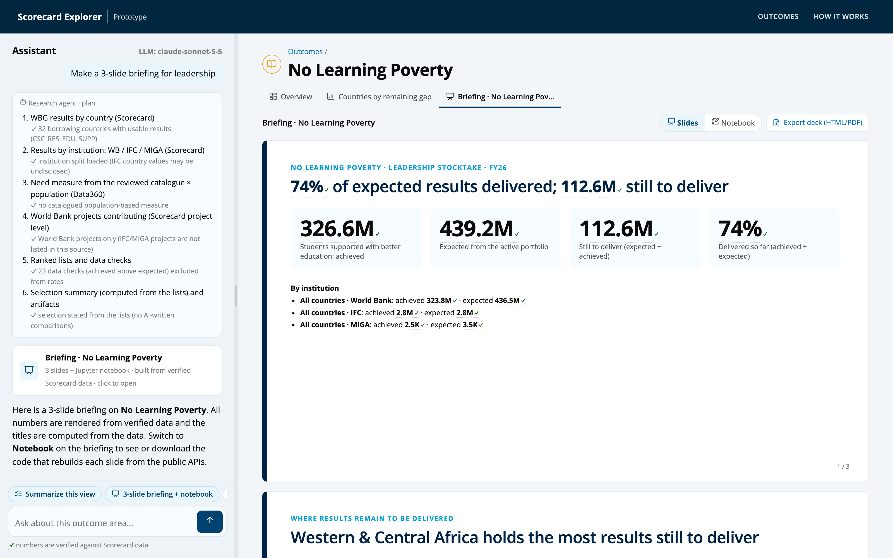

# WBG Scorecard: LLM-powered explorer (Q1) and executive stocktake (Q3)

**Candidate:** Edward Amoah · ETC Data Scientist technical assessment
**Questions completed:** **Question 1** (interactive, LLM-powered Scorecard prototype) and **Question 3** (Scorecard data pipeline
and executive 3-slide deck). Question 2 was not attempted.

The original assessment brief is archived in [`docs/assessment_instructions.md`](docs/assessment_instructions.md).

| | Where |
|---|---|
| Q1 web app (Django) | [`q1_prototype/`](q1_prototype/) |
| Q3A data pipeline, shared with Q1 | [`pipeline/`](pipeline/), documented in [`pipeline/README.md`](pipeline/README.md) |
| Q3B 3-slide deck (No Learning Poverty) | [`q3_scorecard_deck/output/deck_no-learning-poverty.pdf`](q3_scorecard_deck/output/deck_no-learning-poverty.pdf) · [HTML](q3_scorecard_deck/output/deck_no-learning-poverty.html) · [Q3 README](q3_scorecard_deck/README.md) |
| Q3 reproducible notebook | [`notebook_no-learning-poverty.ipynb`](q3_scorecard_deck/output/notebook_no-learning-poverty.ipynb) · [executed](q3_scorecard_deck/output/notebook_no-learning-poverty.executed.ipynb) |
| Data (raw extracts, clean tables, database) | [`data/`](data/) |
| Model evaluation (30 golden questions) | [`q1_prototype/assistant/evals/`](q1_prototype/assistant/evals/) |
| Design notes, reviews, screenshots | [`docs/`](docs/) |
| AI coding assistant logs (complete, unedited) | [`chat_logs/`](chat_logs/) |

## Run it (3 commands)

```bash
python3 -m venv .venv && source .venv/bin/activate && pip install -r requirements.txt
cp .env.example .env      # then set LLM_API_KEY (and LLM_MODEL / LLM_FAST_MODEL to use another provider)
cd q1_prototype && python manage.py migrate && python manage.py runserver 8765   # open http://127.0.0.1:8765
```

The repository includes the processed Scorecard database (`data/scorecard.duckdb`), so the app runs immediately. To
re-pull everything from the live APIs, run `python -m pipeline` (about 4 minutes; see [`pipeline/README.md`](pipeline/README.md)).
Without an API key the Overview pages, filters and charts still work; the assistant explains that it needs a model.

**Plugging in your own model.** All calls go through [LiteLLM](https://docs.litellm.ai), so any provider works by setting
three variables in `.env`:

| Variable | Default | Examples |
|---|---|---|
| `LLM_MODEL` | `anthropic/claude-sonnet-5-5` | `openai/gpt-4o`, `gemini/gemini-2.0-flash` |
| `LLM_FAST_MODEL` | `anthropic/claude-haiku-5-5` | the router; defaults to `LLM_MODEL` |
| `LLM_API_KEY` | | your key |
| `LLM_API_BASE` | | an OpenAI-compatible endpoint, e.g. `http://localhost:11434` for Ollama |

## Screenshots

**Outcome page.** The assistant sits in a resizable left sidebar. The Overview rebuilds the Scorecard data page for the
selected indicator, with filters for fiscal year, institution, area and female/youth/disability. It shows the header with project
count, a map/table, institution/region/income tabs, shares, country groups, and the World Bank Operations project table
with a check that projects add up to the published total.


**A natural-language question with verified numbers.** Every number carries a ✓ that, on hover, shows the area, measure,
snapshot and source row. The answer also produced a ranked figure and listed the World Bank projects behind Nigeria's
numbers, with the sum check.


**The 3-slide briefing.** One click builds the leadership deck (Q3B) with a Slides | Notebook switch. The notebook rebuilds
each slide from the public APIs; it can be copied cell by cell or downloaded.


More: [landing page](docs/screenshots/1_landing.png) · [briefing notebook view](docs/screenshots/5_briefing_notebook.png).

---

## Q1 · Architecture and LLM strategy

### Data flow

```
 Scorecard data API ─┐   (getSCSUMMARYDATA by region/FCS/country/institution, getSCResultIndicatorSummary = projects,
 Scorecard CMS API  ─┤    getSCMETADATA, CMS outcome areas and descriptions)
 Data360 (WDI)      ─┤
                     ▼
   pipeline/  extract → transform → load → validate  ──►  data/raw (unmodified) · data/processed (typed) · data/scorecard.duckdb
                                                                                                  │ (read-only, no external access)
                                                                                                  ▼
   Django app  ── explorer/  Overview data page (queries.py → JSON → Plotly), landing tiles
               └─ assistant/ router → pipelines → typed tools (DuckDB) → claims → server-rendered answer / figure / deck + notebook
```

### How the LLM interacts with the data

The design rule is that **the model never writes a number.** Numbers come only from typed database queries, and the server
renders them.

1. **Router (fast model, Haiku).** It classifies each message into one intent and extracts entities as JSON. The intents are filter, analyze, explain, summary, research, deck,
   notebook, navigate, clarify and out_of_scope. Every code it returns is validated: outcome ids against the outcome table, and
   places by exact lookup in a name/alias table (no fuzzy or keyword matching). The router sees the last three exchanges, stored
   as the text the user actually saw, so follow-ups such as "how does this compare?" resolve.
2. **Pipelines (deterministic code).** These do most of the work without free generation:
   - **filter** changes the Overview;
   - **explain** quotes the Scorecard definition verbatim;
   - **research** and **deck** compute ranked lists and build the 3-slide briefing and its notebook with no model-written text.
3. **Analysis tool loop (main model, Sonnet).** For open questions the model calls **typed, read-only tools**, at most 6 calls
   per question:
   - `get_results`, `rank_areas`, `compare_snapshots`, `get_context` and `outcome_overview` for results and context;
   - `search_indicators` and `get_definition` for metadata;
   - `get_projects`, which lists the World Bank projects behind a number and checks they add up to the published total;
   - `run_sql` as a last resort: one `SELECT` over allow-listed views, parsed by sqlglot, with a forced `LIMIT 200`.

   Arguments are validated with pydantic before any query runs: indicator and area codes against allow-lists, snapshot
   years, institutions. Errors come back to the model as structured hints, so it can correct itself.
4. **Proof-Carrying Numbers.**
   - **Claims:** every value a tool returns is registered as a *claim*, recording the entity, measure, snapshot, source
     and raw value.
   - **Rendering:** the answer's numbers are rendered **by the server** from those claims, each with a ✓ whose tooltip
     shows its provenance.
   - **Model text:** the model writes only a short interpretation, and it is validated. It may contain no digits and may
     name only places that appear in the facts. If it fails, it is dropped, and the user sees that it was withheld.
5. **Data-quality rules in code, not prompts.**
   - **Delivery rate:** shown only when 0 ≤ achieved ≤ expected. Achieved above expected is labelled a data check.
   - **Undisclosed values:** IFC values the API doesn't disclose are shown as "not disclosed".
   - **Units:** emissions values arrive in tonnes although labelled megatonnes, and are corrected.
   - **Project counts:** shown only where the project rows reconcile with the published total.

**Error handling.** The app degrades in steps rather than failing:
- **Model or network errors:** the user gets a friendly message and charts keep working.
- **Invalid tool arguments:** returned to the model with a hint.
- **Tool budget:** capped at 6 calls per question.
- **Rate limit:** per-session.
- **Input length:** bounded.
- **Database:** DuckDB is opened read-only with external access disabled.

Design history and reviews:
- [`docs/platform_architecture.md`](docs/platform_architecture.md) and [`docs/platform_design.md`](docs/platform_design.md);
- a stage-by-stage root-cause review of an early wrong research answer:
  [`docs/review/research_pipeline_review.md`](docs/review/research_pipeline_review.md).

### Model choice and justification

**Default:** Claude **Haiku 5.5** as the router and Claude **Sonnet 5.5** for the analysis tool loop, switchable through
`.env`. Every pairing was tested on **30 golden questions** whose answers come from the live Scorecard API (built with
`python manage.py run_evals --build`). The set covers:
- filters;
- single-area lookups;
- comparisons and rankings;
- definitions;
- questions with no data;
- out-of-scope requests.

A question counts as correct only if:
- the intent and filters are right;
- every expected number appears among the verified claims;
- there are no errors.

Run on the current build (2026-10-17):

| Router : main model | Accuracy | Numbers correct | Filters correct | Verified numbers | p50 latency | p95 latency | $ / question | $ / 1,000 questions |
|---|---|---|---|---|---|---|---|---|
| Haiku 5.5 : Haiku 5.5 | 100% | 18/18 | 8/8 | 100% | 4.7 s | 6.9 s | $0.0008 | $0.76 |
| **Haiku 5.5 : Sonnet 5.5 (default)** | **100%** | **18/18** | **8/8** | **100%** | **5.2 s** | **7.4 s** | **$0.012** | **$11.87** |
| Sonnet 5.5 : Opus 5.5 | 100% | 18/18 | 8/8 | 100% | 7.3 s | 12.4 s | $0.028 | $28.23 |

Opus adds latency and cost (2.4× the default) without improving accuracy on this set, because answers are grounded in tools rather than in model knowledge.

Full per-question results are in [`q1_prototype/assistant/evals/results/`](q1_prototype/assistant/evals/results/).

- **Accuracy and reasoning.**
  - **Why the scores tie:** all pairings are accurate here because correctness does not depend on the model. Numbers are
    fetched by typed tools and rendered by the server, the router's outputs are validated against allow-lists, and
    research and briefings are deterministic.
  - **Where model size matters:** planning several tool calls for open, multi-part questions, such as "which countries…
    and which projects are behind Nigeria's numbers?", and writing a careful interpretation. That is why Sonnet is the
    default main model.
  - **When to drop to Haiku:** the table shows Haiku alone is a sound choice when cost matters most.
- **Speed.** A small model routes every message in about 1 second. Most requests (filters, definitions, briefings) need no
  further model call, and answers stream progress events as the work happens.
- **Cost and scale.**
  - **Per question:** about $0.012 with the default and $0.0008 with Haiku only. The research and briefing paths cost only
    the router call.
  - **Limits:** sessions are rate-limited, and the tool loop is capped at 6 calls.
- **Guardrails against made-up numbers.**
  - **Numbers:** the model cannot print a number. Numbers are rendered from claims with provenance; model text with digits,
    or naming places not in the facts, is dropped.
  - **Comparisons:** where model-written comparisons proved unreliable in testing (for example, "the region furthest
    behind" when another region was further behind), the text was replaced by statements computed from the data.
  - **SQL and arguments:** SQL is read-only and allow-listed, and tool arguments are validated.
- **Portability.** All providers run through LiteLLM. Claude-specific settings (the `effort` level, no `temperature`) are
  applied only to Anthropic models, so OpenAI, Gemini or Ollama models can be configured in `.env`.

---

## Q3 · Data pipeline and executive deck

**Part A: pipeline** ([`pipeline/README.md`](pipeline/README.md)). `python -m pipeline` pulls three Scorecard snapshots (FY24
to FY26), about 2,300 parallel API requests with retries, plus Data360. It writes raw extracts unmodified, then cleans and types them. Cleaning handles:
- numbers stored as text and in scientific notation;
- ISO2-like Bank codes;
- period ranges;
- repeated keys;
- IDA21 repeat project rows;
- disability-inclusive projects, which are an attribute rather than a breakdown;
- the FY26 `FCV` code.

It loads DuckDB views and writes a data-quality report: duplicates, achieved above expected, region-sum mismatches, and
project-to-total reconciliation (16 of 19 indicators reconcile exactly in FY26).

**Part B: 3-slide stocktake on No Learning Poverty** ([Q3 README](q3_scorecard_deck/README.md)).
- **Portfolio:** it has supported 326.6M students of the 439.2M expected (74%).
- **Regions:** Western & Central Africa holds the most still to deliver.
- **Priority countries:** selected by one rule, most still to deliver: **Nigeria, Philippines and Uganda**.
- **Reproducibility:** the deck is the app's briefing export. Its notebook rebuilds every slide from the public APIs and
  passed 12 of 12 checks.

---

## Data

| Path | Content |
|---|---|
| `data/raw/fy2024 … fy2026/`, `data/raw/global/` | Unmodified API extracts (Parquet, all columns as text) |
| `data/processed/*.parquet` | Clean, typed tables |
| `data/scorecard.duckdb` | Tables + analysis views read by the app |
| `data/processed/data_quality.json` | Data-quality report from the last run |

Sources and API access, including how the Scorecard's public API key is read at run time from the site's JavaScript
bundle, are documented in [`pipeline/README.md`](pipeline/README.md).

## AI coding assistant logs

The whole project was built with **Claude Code** (Anthropic). [`chat_logs/`](chat_logs/) holds the **complete, unedited**
session transcript and the transcripts of two research subagents:
- **Main transcript:** `chat_logs/57c09fbc-a25d-4f8b-a99b-bcb158d09225.jsonl.gz`. The raw file exceeds GitHub's 100 MB
  limit, so it is gzip-compressed; this is lossless, and `gunzip -k` restores the identical file.
- **Subagents:** `chat_logs/57c09fbc-…/subagents/*.jsonl`.
- **Refreshing:** [`chat_logs/sync_logs.sh`](chat_logs/sync_logs.sh) re-copies the logs from Claude Code's session store.
