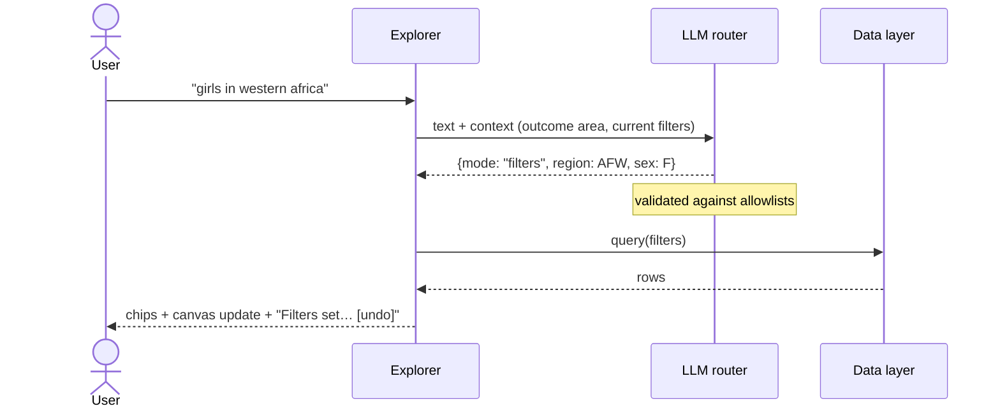
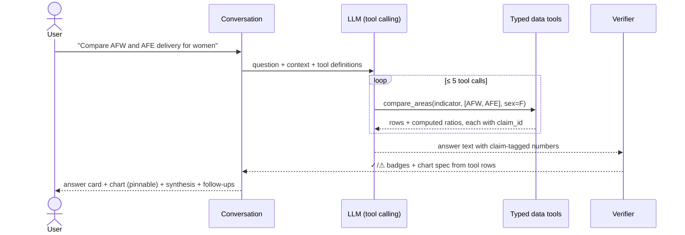

# Scorecard Explorer: Platform Design (DRAFT v0.4)

> Working document. Edit freely. Decisions to make are marked **[DECIDE]**, and open questions **[?]**.
> v0.2: narrowed to **Outcome Areas + interaction with the data**, as set out in the management mandate.
> Architecture goes in a separate file (`docs/platform_architecture.md`) once the design is agreed.

---

## 1. The mandate drives the design

> *"…re-imagine the Scorecard as an immersive, highly interactive web application. Global users … should be able to
> explore the data dynamically and ask complex analytical questions in natural language. … an LLM integrated directly
> into the app that can intelligently query our indicators database, synthesize findings, and generate accurate
> insights on demand. Innovation and visual polish are paramount."*

| Mandate phrase | Design answer |
|---|---|
| "rather than static dashboards or raw data tables" | Outcome tiles and charts carry live numbers and respond to every interaction; no tables by default |
| "immersive, highly interactive" | One **Explorer** workspace per outcome area: charts and the conversation sit side by side and drive each other |
| "explore the data dynamically" | Click the map → filter; type "girls in Ghana" → filter; edit chips by hand; switch snapshot FY24 ↔ FY25 ↔ FY26 |
| "ask complex analytical questions in natural language" | A conversation dock that handles comparisons, rankings, trends and gaps across areas, regions and country groups |
| "intelligently query our indicators database" | LLM tool calling over typed, read-only queries on the WBG Results database |
| "synthesize findings" | Every view gets an automatic **"What this shows"** insight strip, and answers end with a short synthesis |
| "generate accurate insights" | **Verified numbers**: every figure the LLM writes is checked against the data (✓ / ⚠) |
| "innovation and visual polish" | Answers produce their own charts, which can be **pinned to the canvas**; a consistent editorial visual theme |

**Scope rule:** if a feature doesn't serve *Outcome Areas* or *interaction with the data*, it's out.
(Removed in v0.2: country profile page, separate About page, KPI strip, contributing-projects drawer.)

---

## 2. Two surfaces only

```
/                      OUTCOMES: entry point. 15 live outcome tiles + "Ask the Scorecard"
/outcomes/<slug>/      EXPLORER: the immersive workspace for one outcome area (canvas + conversation)
```
Methods and data sources live in a **"How this works" modal**, reachable from both surfaces, not a separate page.

---

## 3. Surface 1: Outcomes (entry)

```
┌──────────────────────────────────────────────────────────────────────────────┐
│ Scorecard Explorer                                         How this works ⓘ   │
├──────────────────────────────────────────────────────────────────────────────┤
│  How is the World Bank Group delivering on its mission?                        │
│  ┌──────────────────────────────────────────────────────────────┐  [ Ask ]    │
│  │ 🔍 "Which outcome areas are furthest from expected results?"  │             │
│  └──────────────────────────────────────────────────────────────┘             │
│  Try: [Energy access in Western Africa] [FCS vs all countries] [Biggest gaps]  │
├──────────────────────────────────────────────────────────────────────────────┤
│  [All] [People] [Prosperity] [Planet] [Infrastructure] [Digital]               │
│  Sort: [Scorecard order ▾ | Largest gap | Most reached]                        │
│ ┌────────────────┐ ┌────────────────┐ ┌────────────────┐ ┌────────────────┐   │
│ │ PEOPLE          │ │ INFRASTRUCTURE  │ │ PEOPLE          │ │ …              │   │
│ │ No Learning     │ │ Energy for All  │ │ Healthier Lives │ │                │   │
│ │ Poverty         │ │                 │ │                 │ │                │   │
│ │ 326.6M of 439.2M│ │ 214.5M of 575.6M│ │ …               │ │                │   │
│ │ students reached│ │ people w/ power │ │                 │ │                │   │
│ │ ███████░░  74%  │ │ ███░░░░░░  37%  │ │                 │ │                │   │
│ │ Need ↗ 53.6%    │ │ Need ↗ …        │ │                 │ │                │   │
│ └────────────────┘ └────────────────┘ └────────────────┘ └────────────────┘   │
└──────────────────────────────────────────────────────────────────────────────┘
```

- **Tile:** outcome name + vertical, the main **WBG Results** indicator (achieved of expected, progress bar),
  and the main **Client Context** need with a small trend line. Hover → definition. Click → Explorer.
- **Ask from here:** a question about one area ("energy access in Western Africa") opens that area's Explorer with
  filters already applied. A question across areas ("biggest gaps") opens the conversation dock with a ranked answer,
  and the tiles named in the answer are highlighted.
- [?] "% of expected" is our own derived ratio (achieved ÷ expected from the active portfolio), **not an official
  target**. We label it that way and use neutral colours, not red/green. Indicators that aren't counts
  (GHG emissions, % of economies) show their value without a bar.

---

## 4. Surface 2: Outcome Explorer (the immersive workspace)

```
┌──────────────────────────────────────────────────────────────────────────────────────────┐
│ ← Outcomes  /  Affordable, Reliable & Sustainable Energy for All        INFRASTRUCTURE     │
├──────────────────────────────────────────────────────────────────────────────────────────┤
│ Filters: [Org: WBG ▾] [Region ▾] [Country ▾] [Income ▾] [Group ▾] [Female] [Youth] [Disab.] │
│          Snapshot: (FY24) (●FY25) (FY26)                                                   │
├──────────────────────────────────────────────────────┬───────────────────────────────────┤
│ CANVAS                                                │ CONVERSATION                       │
│ ✨ What this shows (auto-synthesis, verified):         │                                    │
│   • 214.5M ✓ people reached, 37% ✓ of 575.6M ✓       │ You: girls in western africa       │
│     expected.  • Western & Central Africa holds the   │ ↳ Filters set: Region = AFW,       │
│     largest gap …                                     │   Female ✓   [undo]                │
│ ┌──────────────── Client Context: the need ────────┐  │                                    │
│ │ % population with electricity                     │  │ You: how does that compare to      │
│ │ line: selection vs world vs region, 2011–2024     │  │      Eastern & Southern Africa?    │
│ └──────────────────────────────────────────────────┘  │ ┌ Answer card ─────────────────┐   │
│ ┌──────────────── WBG Results: delivery ───────────┐  │ │ AFW 12.1M ✓ / 48.0M ✓  (25%) │   │
│ │ People provided with electricity                  │  │ │ AFE 31.4M ✓ / 70.2M ✓  (45%) │   │
│ │ 214.5M achieved | 575.6M expected  ████░░ 37%     │  │ └──────────────────────────────┘   │
│ │ [Map] [By region] [By institution] [Ach|Exp]      │  │ [mini bar chart]  📌 Pin to canvas │
│ │  choropleth (click a country → filter)            │  │ Summary … ✓ verified ⚠ unverified  │
│ └──────────────────────────────────────────────────┘  │ ▸ How I got this · Sources         │
│ 📌 Pinned: [AFW vs AFE delivery bar ✕]                 │ Follow-ups: [Which countries…?]    │
│                                                       │ ┌──────────────────────────────┐  │
│                                                       │ │ Ask about energy…            │  │
│                                                       │ └──────────────────────────────┘  │
└──────────────────────────────────────────────────────┴───────────────────────────────────┘
```
*(Figures in the wireframes are illustrative, apart from the FY25 WBG totals already pulled from the API.)*

### 4.1 The canvas: explore by direct interaction
- **Context chart** (the need): time series for the current selection vs world and region.
- **Results card** (delivery): achieved vs expected + progress bar, with views:
  **Map** (click a country → sets the Country filter) · **By region** (bar) · **By institution** (WB / IFC / MIGA).
- **Snapshot switch** FY24 ↔ FY25 ↔ FY26 animates the change. WBG Results have one value per snapshot, so this is how
  "progress over time" is shown.
- **"What this shows"**: 2–3 bullet insights generated for the *current* view, all numbers verified. It refreshes when
  the filters change. **[DECIDE]** generate it automatically on every change (more LLM calls) or on click ("✨ Summarize this view")?
  *Proposal: on click, cached per filter state.*
- **Pinned charts:** charts from conversation answers can be pinned to the canvas, so the user builds a personal view.

### 4.2 The conversation: explore by language
One dock and one input. The LLM decides what each message needs:

| User says | What happens | Shown as |
|---|---|---|
| "girls in Ghana", "IFC only", "FY24" | **Set filters** | Chips update, canvas re-renders; "Filters set: …  [undo]" |
| "how does that compare to Eastern Africa?" | **Analyze** | Answer card + chart + verified narrative |
| "which countries drive the gap?" | **Analyze** (ranking) | Ranked bar + narrative; clicking a bar sets the filter |
| "what does 'expected' mean?" | **Explain** (from metadata) | Definition from the indicator metadata, with its source |
| "Ghana" (ambiguous on the entry page) | **Clarify** | "Which area? [Education] [Energy] [All areas]" |
| "write a poem" | **Out of scope** | Polite redirect + suggested questions |

- **Context aware:** the LLM knows the current outcome area and filters, so follow-ups like "and for youth?" work.
- **Verified numbers (Proof-Carrying Numbers):** every figure from data carries ✓ (hover: indicator, area,
  snapshot, raw value). Anything the system can't trace shows ⚠. Ratios and differences are computed in code,
  not by the LLM, so they are verifiable too.
- **"How I got this":** collapsible list of the filters and queries used. Shows the work without cluttering the answer.
- **Follow-up chips:** 2–3 next questions written in the user's voice.

### 4.3 How the two halves connect
- Language → canvas: filter changes, highlighted regions/countries, pinned charts.
- Canvas → language: clicking the map, chips or bars updates the context the conversation uses
  ("Ghana selected. Ask me about it.").

---

## 5. Key flows

### 5.1 Language → filters


### 5.2 Complex question → verified insight


---

## 6. Visual design
- **Look:** modern editorial data journalism: white panels, generous spacing, one accent colour per vertical.
  Clearly a prototype, not a copy of official WBG branding. **[DECIDE]** light only, or light + dark?
- **Vertical colours:** People `#F28C28` · Prosperity `#7B61FF` · Planet `#2E9E5B` · Infrastructure `#D9483B` · Digital `#1F8FD6`.
- **Delivery scale:** neutral sequential colours (no red/green pass/fail), because "expected" is not a target.
- **Motion:** smooth chart transitions on filter and snapshot changes; skeleton loaders while the LLM works.
- **Charts:** Plotly.js with one shared theme; choropleth by ISO3. **Type:** Inter, tabular numbers.
- **Accessibility:** contrast AA, keyboard-operable chips and chat, chart alt text summarising the takeaway.

---

## 7. Data behind each element
| Element | Source |
|---|---|
| Tiles, Results card, map, by-region, by-institution | Scorecard `getSCSUMMARYDATA` (area × org × sex/age/disability × snapshot) + `getSCMETADATA` |
| Context chart | Scorecard Client Context time series (by area) |
| Outcome descriptions | Scorecard CMS `get_outcomes_indicators` |
| Per-capita framing (optional) | Data360 population (WDI), via ISO3 |
| Conversation tools | The same database, through typed read-only queries |

**[?] To check in the pipeline:** whether the API accepts Income groups and Country groups (IDA, LDC, SIDS, small states)
as area types. If not, we compute them from country rows and label them "computed".

---

## 8. Scope
| Priority | Feature |
|---|---|
| **Must** | Outcomes tiles with live numbers + Ask · Explorer: filters, Context chart, Results card (map / region / institution) · conversation with filter mode + analyze mode · verified numbers ✓/⚠ · "How this works" modal · `.env.example` plug-and-play |
| **Should** | "What this shows" synthesis · follow-up chips · "How I got this" · snapshot switch FY24–26 · click map → filter |
| **Could** | Pin answer charts to canvas · highlight tiles from cross-area answers · dark mode |
| **Won't** | Country profiles, project drill-downs, accounts/saved chats, voice, multilingual UI |

## 9. Open decisions
1. "What this shows": automatic or on click? → *proposal: on click, cached*
2. Light only, or light + dark?
3. Pin-to-canvas: Should or Could?
4. Product name: "Scorecard Explorer"?


---

## 10. v0.3 changes (from mockup review)
- **Landing simplified** to the live Scorecard's tile style: icon, short bold-led title, large achieved figure, expected
  figure, mini achieved/expected bars. No context lines or footnotes.
- **Map restored** as the default Results view (Achieved / Expected toggle), as on the live indicator page; selecting a
  region or country zooms the map; clicking a country sets the Area filter.
- **One assistant panel** above the two figures replaces the side chat + separate "What this shows" box:
  ask (text), **Summarize this view**, **Explain with video**, suggested questions, and the thread, in one place.
- **Light theme only**, with tokens aligned to worldbank.org (`--brand-dark-blue #002244`, `--brand-blue #009fda`,
  `--domain-primary #004370`, links `#0071bc`) and **Open Sans** (the Scorecard's fallback for its licensed Andes font).
- **Results stories feed**: the Scorecard CMS `get_home_narratives` (14 FY26 stories with images) appears as a small
  "Results stories" row on the landing page and a "Related results story" card on each outcome page.
- **Default snapshot = latest (FY26)**, matching the live site.
- **Video explainers**: concept preview in the mockup (narration is the only voice feature); plan in `docs/vision_voice_video.md` (not part of the brief).


## 11. v0.4: indicator page = chat + artifacts workspace
- **Layout:** like a modern AI assistant. **Chat on the left** (thread, quick actions, text input) and an
  **Artifacts panel on the right** with tabs. No stories on the indicator page (stories stay on the landing page).
- **Artifacts always open with "Overview":** the two figures of the current Scorecard indicator page
  (Client context trend + WBG Results with Map / By region / By institution / Over time) and their filters.
  Chat requests and map clicks drive these filters.
- **Generated artifacts** (all built only from verified data, every number ✓):
  | Type | What it is | Exports |
  |---|---|---|
  | Figure | comparison / ranking chart created from a question | PNG, notebook |
  | Video explainer | scripted walkthrough with synced scenes (concept: browser voice) | notebook |
  | Briefing deck | 3-slide leadership stocktake: where we stand → where the gaps are → three-year priorities (need × remaining-gap scoring) | HTML/PDF, notebook |
  | Notebook | Jupyter notebook that re-downloads the same data from the Scorecard API, cleans it, re-verifies the ✓ values, reproduces the figure and saves CSV | .ipynb |
- **Link to Q3:** the notebook export is a reproducible pull → clean → structure → verify pipeline for any artifact
  (supports **Q3A**, alongside the shared `pipeline/` module); the briefing deck is the format for **Q3B**.
  Tested: a generated notebook ran end to end against the live API (7/7 values ✓).


## 12. v0.5: voice scope
- **Removed** voice input (🎤) and spoken chat replies. Questions are typed only.
- **Voice is used only for narrating the video explainer.**
