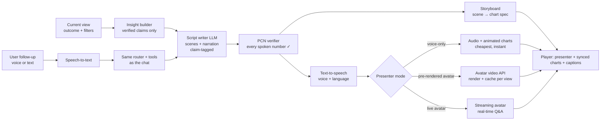

# Vision: Voice & Video Explainers for the Scorecard (exploratory, beyond the brief)

> **Scope decision (v0.5):** the product uses voice **only for video-explainer narration**. Voice questions and spoken chat replies were tried in the mockup and removed; they stay listed below as possible future work.
>
> Status: **concept / plan only**. Not part of the Q1 requirements. The mockup (`docs/mockups/`) includes a working
> *preview* (🎬 "Explain with video" and 🎤 voice input), built with the browser's own speech APIs in place of a real
> generated presenter.

## 1. The idea
Make the Scorecard feel like a conversation with a knowledgeable analyst, not a dashboard:
- **Watch:** "Explain this view" produces a 60–90 second narrated explainer: a presenter (avatar or voice-only) walks
  through the current selection, scene by scene, with the charts animating in sync.
- **Ask:** at any point, the user can ask a follow-up **by voice or text** ("why is South Asia lower?"). The answer
  comes back spoken and on screen, grounded in the same verified data.
- **Accessible by default:** captions, transcripts, and audio-first answers for users with low literacy or visual
  impairments, plus multilingual narration for a global audience.

## 2. How it would work

**Key principle: the script is built only from verified claims.** The same Proof-Carrying Numbers check that guards
chat answers runs on the narration script *before* any audio or video is generated. A presenter can never say a
number that isn't traceable to a source row. Each scene stores its claim IDs, so captions show ✓ links too.

### Three presenter modes (progressive cost and complexity)
| Mode | What the user gets | How | Latency | Cost driver |
|---|---|---|---|---|
| **1. Voice + animated charts** | Narration over charts that change scene by scene, with captions | TTS API (or browser speech, as in the mockup) | ~1–3 s to start (streamed) | TTS characters, very low |
| **2. Pre-rendered presenter video** | A talking-head presenter beside the charts | Avatar video API renders the script; **cached** per (outcome, filters, snapshot) | Minutes to render; instant when cached | Per-second of rendered video |
| **3. Live interactive presenter** | Real-time spoken Q&A with an avatar | Streaming avatar + speech-to-speech model with **the same tools** as the chat | ~1–2 s per turn | Per-minute streaming session |

**Recommended path:** ship **Mode 1** first (cheap, fast, fully grounded). Pre-render **Mode 2** only for the ~15
outcome-area overviews per snapshot (a fixed, cacheable set). Pilot **Mode 3** later for events and briefings.

### Voice Q&A
- **Simple pipeline:** speech-to-text → the existing router + tools + verifier → text-to-speech. It reuses everything
  already built, so it's predictable and verifiable.
- **Speech-to-speech realtime models** (single socket, lower latency, support tool calling) are the alternative for Mode 3.
  The tools stay the same; the verifier still checks the transcript before the answer is shown as text.

## 3. Options landscape (to verify at build time; prices change often)
| Need | Options | Notes |
|---|---|---|
| Avatar video (pre-rendered) | HeyGen API, Synthesia, D-ID, VEED Fabric | HeyGen publishes per-second API rates; Synthesia API access is tied to higher/enterprise tiers |
| Live / streaming avatar | HeyGen LiveAvatar, D-ID agents, Tavus | Priced per credit/minute; concurrency limits apply |
| Speech-to-speech / realtime voice | OpenAI Realtime (`gpt-realtime`), ElevenLabs agents, Deepgram Voice Agent, Microsoft Voice Live | Support tool calling; compare on latency, interruption handling, languages |
| TTS / STT (pipeline) | Any major TTS/STT provider; the browser Web Speech API for prototypes | The mockup uses the browser APIs (no keys, no cost) |

Sources: [HeyGen: avatar APIs 2026](https://www.heygen.com/blog/best-ai-avatar-talking-head-apis) ·
[HeyGen vs Synthesia vs D-ID](https://www.heygen.com/blog/heygen-vs-synthesia-vs-d-id) ·
[VEED: best avatar APIs](https://www.veed.io/learn/best-avatar-apis) ·
[Kompozy comparison](https://kompozy.io/ai-video-generation/avatar-video-comparison) ·
[OpenAI: introducing gpt-realtime](https://openai.com/index/introducing-gpt-realtime/) ·
[AssemblyAI: realtime API alternatives](https://assemblyai.com/blog/openai-realtime-api-alternatives).
Several of these are vendor-authored; treat prices and latency claims as indicative.

## 4. Guardrails specific to voice & video
- **Grounding:** narration = verified claims only; scripts that fail verification are not rendered.
- **Disclosure:** a visible "AI-generated presenter" label and a watermark on every video; no likeness of real staff
  without explicit consent; a stock or illustrated presenter by default.
- **Accessibility:** captions always on; downloadable transcript; audio descriptions of charts.
- **Languages:** narration in the user's language, with numbers formatted for that locale (still verified against the source values).
- **Cost control:** cache by (outcome, filters, snapshot, language); render on demand only for popular views;
  per-session limits for live mode.
- **Privacy:** voice audio is not stored by default; transcripts are kept only for the session.

## 5. Phased plan
| Phase | Scope | Effort (indicative) |
|---|---|---|
| 0. Prototype (done in mockup) | Script from verified insights, scenes synced to charts, browser TTS + speech input | — |
| 1. Voice explainers | Server-side TTS, streamed audio, captions, 3–5 languages; voice questions via STT → existing pipeline | ~1–2 weeks |
| 2. Presenter videos | Avatar API rendering for the 15 outcome overviews per snapshot; CDN caching; disclosure labels | ~2–3 weeks |
| 3. Live presenter | Streaming avatar + realtime voice with the same tools; pilot for briefings | ~4+ weeks + vendor review |

## 6. How to evaluate it
Comprehension (quick quiz after viewing vs reading), time-to-insight, completion rate, follow-up question rate,
verified-number rate in narration (target 100%), latency to first audio, and cost per explainer view.
